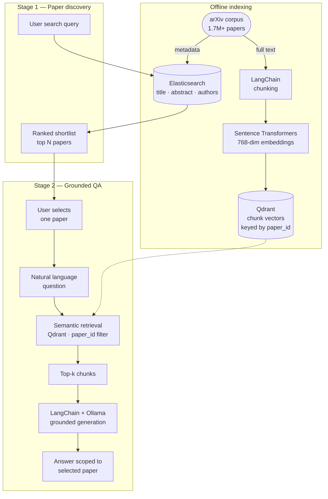

# Designing a Hybrid RAG Architecture for Academic Research

With over 1.7 million open-access papers on arXiv—and thousands added every month—researchers face a familiar problem: finding a paper is easy, but understanding what it actually says is slow. Keyword search returns long lists. Reading every abstract is tedious. And once you pick a paper, you still have to hunt through dense technical prose for the one paragraph that answers your question.

I built a question-answering system for academic literature that tackles this differently. Instead of treating the entire corpus as one retrieval pool at answer time, it separates **paper discovery** from **paper comprehension**. Users first find candidate papers through fast keyword search, select one, then ask natural-language questions scoped strictly to that document. This post explains the architecture, the design trade-offs, and what I'd improve next—without tying the patterns to any single product name.

## Information needs the architecture supports

The system is designed around how people actually read research—not how search engines index it:

| Need                                | Example question                                                     | Architectural response                                                      |
| ----------------------------------- | -------------------------------------------------------------------- | --------------------------------------------------------------------------- |
| **Factual lookup**                  | "What architecture does this paper propose?"                         | Retrieve exact chunks from the selected paper; LLM summarizes grounded text |
| **Concept explanation**             | "Explain the attention mechanism as described here"                  | Semantic chunk retrieval + generative explanation                           |
| **Focused literature review**       | "What does this paper say about reinforcement learning in robotics?" | Topic-scoped retrieval within one document at a time                        |
| **Author and contribution context** | "Who are the authors and what do they propose?"                      | Metadata + content retrieval from the selected source                       |

The key constraint: **answers are always grounded in a user-selected paper**. The system does not hallucinate across the full corpus or synthesize from papers the user never chose.

## Target domain

The corpus is academic STEM content from arXiv—computer science, artificial intelligence, machine learning, physics, mathematics, and engineering. These fields share traits that shaped the design:

- Rapid terminology churn (transformers, diffusion models, federated learning)
- Dense technical language that punishes naive keyword matching
- High value in paraphrase-tolerant search once a paper is selected

The same patterns extend to interdisciplinary areas on arXiv—computational biology, quantum computing, robotics—where regular search engines struggle with cross-domain vocabulary.

## High-level system design

The architecture is a **two-stage pipeline**, not a single hybrid retriever over the full dataset:



**Stage 1** narrows 1.7 million papers to a shortlist using Elasticsearch on title, abstract, and author fields. This is fast, predictable, and cheap.

**Stage 2** activates only after paper selection. Semantic search and LLM generation run against chunks from that single document—ensuring answers are context-specific and verifiable.

This split is deliberate. Running vector search across the entire corpus for every question is slow, noisy, and increases hallucination risk. Scoping retrieval to one paper trades breadth for precision—the right trade-off for focused reading and literature review workflows.

## Ingestion and indexing

### Metadata index (Elasticsearch)

For discovery, only lightweight metadata is indexed:

- Title
- Abstract
- Authors
- Categories
- Publication date

Elasticsearch handles BM25-style keyword matching. Users can search by author name, model acronym, or topic keyword without needing exact phrasing. This stage reduces the candidate set before any embedding computation at query time.

### Content index (Qdrant + Sentence Transformers)

For answering, full paper text is processed separately:

1. **Chunking** — LangChain splits paper content into smaller segments suitable for embedding and LLM context windows.
2. **Embedding** — Sentence Transformers convert each chunk into a 768-dimensional vector.
3. **Storage** — vectors are stored in Qdrant, keyed by paper ID so retrieval can be filtered to a single document.

Each chunk carries metadata linking it back to its source paper—essential for scoped retrieval in Stage 2.

```python
from langchain.text_splitter import RecursiveCharacterTextSplitter
from sentence_transformers import SentenceTransformer

splitter = RecursiveCharacterTextSplitter(
    chunk_size=512,
    chunk_overlap=64,
)

model = SentenceTransformer("all-MiniLM-L6-v2")

def index_paper(paper_id: str, full_text: str, qdrant_client) -> None:
    chunks = splitter.split_text(full_text)
    vectors = model.encode(chunks)
    qdrant_client.upsert(
        collection_name="arxiv_chunks",
        points=[
            {
                "id": f"{paper_id}_{i}",
                "vector": vec.tolist(),
                "payload": {"paper_id": paper_id, "text": chunk, "chunk_index": i},
            }
            for i, (chunk, vec) in enumerate(zip(chunks, vectors))
        ],
    )
```

Keeping metadata search and content vectors in separate stores mirrors how users think: "find papers about GNNs" (Stage 1) vs. "explain GraphSAGE in _this_ paper" (Stage 2).

## Stage 1: Paper discovery with Elasticsearch

When a user searches the corpus, the query hits Elasticsearch first:

```python
def search_papers(query: str, size: int = 20) -> list[dict]:
    response = es.search(
        index="arxiv_metadata",
        query={
            "multi_match": {
                "query": query,
                "fields": ["title^3", "abstract", "authors"],
            }
        },
        size=size,
    )
    return [hit["_source"] for hit in response["hits"]["hits"]]
```

Boosting title matches (`title^3`) surfaces papers whose primary subject aligns with the query, while abstract and author fields catch secondary signals.

The result is a ranked list—not an answer. The user picks the paper they want to read deeply. This human-in-the-loop step is an architectural feature, not a limitation: it prevents the system from silently choosing the wrong source.

## Stage 2: Scoped semantic retrieval and generation

Once a paper is selected, the question-answering path activates.

### Semantic chunk retrieval

The user's question is embedded with the same Sentence Transformer model. Qdrant returns the top-_k_ chunks **filtered by `paper_id`**:

```python
def retrieve_chunks(paper_id: str, question: str, top_k: int = 5) -> list[str]:
    query_vector = model.encode(question).tolist()
    results = qdrant_client.search(
        collection_name="arxiv_chunks",
        query_vector=query_vector,
        query_filter={"must": [{"key": "paper_id", "match": {"value": paper_id}}]},
        limit=top_k,
    )
    return [hit.payload["text"] for hit in results]
```

Filtering by paper ID is the critical design decision. Without it, semantically similar chunks from unrelated papers leak into the context window—and the LLM will blend them into a plausible but wrong answer.

### LangChain orchestration

LangChain connects retrieval to generation through a prompt template that constrains the LLM to the retrieved context:

```python
from langchain_core.prompts import ChatPromptTemplate
from langchain_core.output_parsers import StrOutputParser
from langchain_core.runnables import RunnablePassthrough

prompt = ChatPromptTemplate.from_messages([
    ("system", "Answer using only the provided paper excerpts. "
               "If the excerpts do not contain the answer, say so."),
    ("human", "Paper excerpts:\n{context}\n\nQuestion: {question}"),
])

chain = (
    {
        "context": lambda x: "\n\n".join(
            retrieve_chunks(x["paper_id"], x["question"])
        ),
        "question": lambda x: x["question"],
    }
    | prompt
    | llm
    | StrOutputParser()
)
```

The system prompt enforces grounding. When retrieval returns weak matches, the model abstains rather than inventing—an important safety property for academic use.

### Local LLM inference with Ollama

All models run locally via Ollama. No external API calls, no data leaving the machine:

```python
from langchain_community.llms import Ollama

llm = Ollama(
    model="llama3",
    base_url="http://localhost:11434",
    temperature=0.1,
)
```

This offline-first design supports:

- **Privacy** — paper content and user questions never transit third-party services
- **Cost predictability** — no per-token billing at scale
- **Institutional deployment** — usable in environments that block cloud AI APIs

The trade-off is operational: you provision GPU/CPU resources, manage model versions, and accept slower generation than hosted APIs. For academic tooling on a dedicated machine, that trade-off is often acceptable.

## User interface: Streamlit

The frontend is a Streamlit application—not a separate API layer. Streamlit handles question input, paper selection, answer display, and metadata rendering in one Python module:

```python
import streamlit as st

st.title("Research Paper QA")

query = st.text_input("Search papers")
if query:
    papers = search_papers(query)
    selected = st.selectbox("Select a paper", papers, format_func=lambda p: p["title"])

if selected:
    question = st.text_input("Ask a question about this paper")
    if question:
        answer = chain.invoke({"paper_id": selected["id"], "question": question})
        st.write(answer)
        st.caption(f"Source: {selected['title']} ({selected['authors']})")
```

For a research prototype, Streamlit eliminates frontend boilerplate. The entire flow—search, select, ask, display—ships in one file. If the system grew beyond a single-user tool, I'd extract the retrieval and generation logic behind a FastAPI service and keep Streamlit as a thin client.

## Why hybrid search, applied sequentially

The report's evaluation found that combining keyword and semantic search outperformed either method alone—but the combination is **sequential**, not fused at every query:

| Stage         | Method                       | Why                                                            |
| ------------- | ---------------------------- | -------------------------------------------------------------- |
| Discovery     | Elasticsearch (keyword/BM25) | Fast filtering across 1.7M records; exact author/title matches |
| Comprehension | Qdrant (semantic vectors)    | Paraphrase-tolerant retrieval within a selected paper          |

This differs from corpus-wide Reciprocal Rank Fusion, where vector and keyword results merge across all documents. Here, each technique operates where it is strongest: keywords for scale, vectors for understanding.

Manual testing across 10 representative queries showed 9 out of 10 answers rated helpful, clear, and relevant—a strong signal for a prototype, though formal IR metrics (precision@k, recall@k) would strengthen the evaluation.

## Example query flows

**Example 1 — Concept explanation**

- Paper selected: a Graph Neural Networks survey
- Question: "What are the latest techniques in graph neural networks?"
- Result: chunks discussing GraphSAGE and attention-based GNNs retrieved; LLM produces a plain-language summary

**Example 2 — Architecture understanding**

- Paper selected: the original Transformer paper
- Question: "Explain how transformer models work in NLP"
- Result: chunks covering self-attention, encoder-decoder structure, and positional embeddings synthesized into an accessible explanation

**Example 3 — Method comparison**

- Paper selected: a comparative study on generative models
- Question: "Compare optimization methods used in GANs and VAEs"
- Result: answer grounded in that paper's comparison of adversarial loss vs. reconstruction + KL divergence

In each case, the answer reflects **one chosen source**—exactly what a researcher needs when doing focused reading.

## Operational considerations

### Fully offline deployment

Every component—Elasticsearch, Qdrant, Sentence Transformers, Ollama—is open-source and runs without cloud dependencies. This makes the system deployable in secure academic environments where external API access is restricted.

### Failure modes

| Failure                      | Mitigation                                             |
| ---------------------------- | ------------------------------------------------------ |
| No relevant chunks retrieved | LLM instructed to say "not found in this paper"        |
| Wrong paper selected         | Human-in-the-loop selection in Stage 1                 |
| LLM timeout                  | Return retrieved chunks without generation as fallback |
| Stale corpus                 | Re-run ingestion pipeline on updated arXiv dumps       |

### Evaluation gaps

Manual satisfaction testing is a start. A production system would add:

- A golden set of question–paper–answer triples
- Automated faithfulness scoring (does the answer appear in retrieved chunks?)
- Latency benchmarks for Stage 1 vs. Stage 2 separately

## Future directions

The current architecture is a solid foundation. Natural extensions:

- **Inline citations** — map answer sentences back to specific chunk indices and page ranges
- **Multi-database ingestion** — extend beyond arXiv to PubMed, IEEE Xplore, or institutional repositories
- **Multilingual support** — multilingual embedding models and translated UI for non-English researchers
- **User feedback loop** — thumbs-up/down on answers to fine-tune retrieval thresholds over time
- **Cross-paper comparison** — a controlled Stage 3 that retrieves from 2–3 user-selected papers with explicit source attribution

## Summary

Effective academic QA is not one retrieval problem—it is two:

1. **Find the right paper** among millions (keyword search at scale)
2. **Understand that paper** deeply (semantic retrieval scoped to one document)

The architecture that worked:

- **Elasticsearch** for fast metadata discovery across the arXiv corpus
- **Qdrant + Sentence Transformers** for 768-dim semantic chunk retrieval within a selected paper
- **LangChain** for chunking, prompt orchestration, and grounded generation
- **Ollama** for fully offline, privacy-preserving LLM inference
- **Streamlit** for a zero-friction research interface

Scoping answers to a user-selected paper is the most important design decision. It sacrifices the illusion of omniscient corpus-wide intelligence in exchange for answers you can actually trust—and for an architecture that scales without drowning every query in 1.7 million embeddings.
